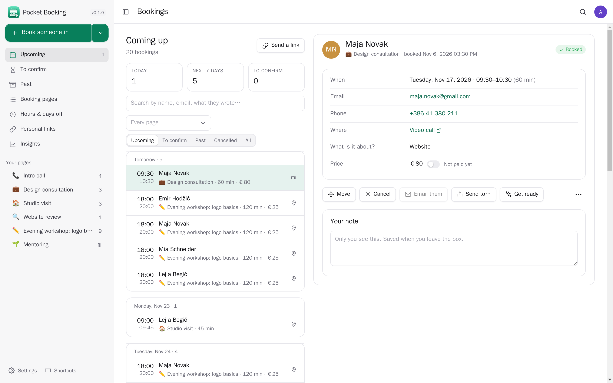
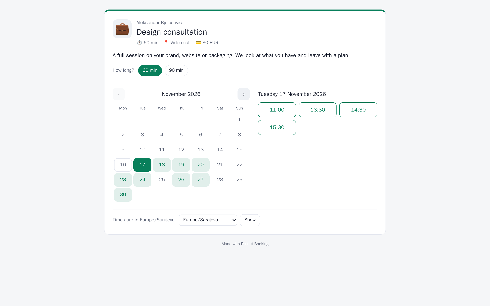
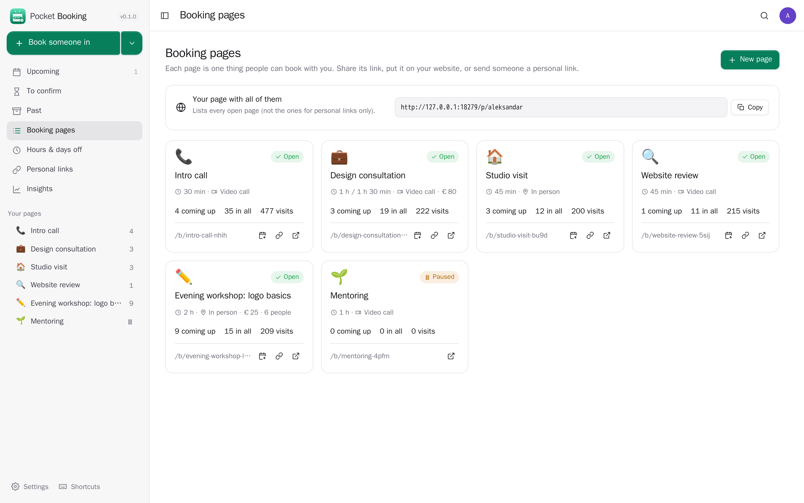
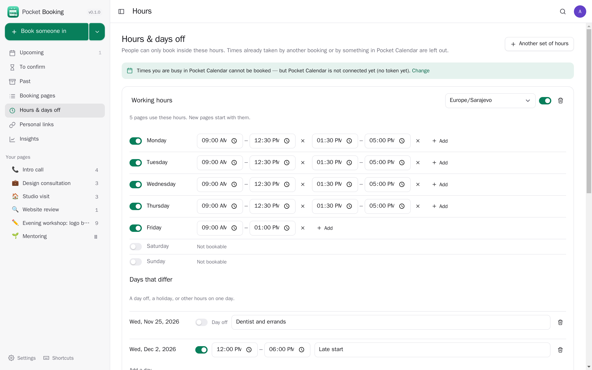
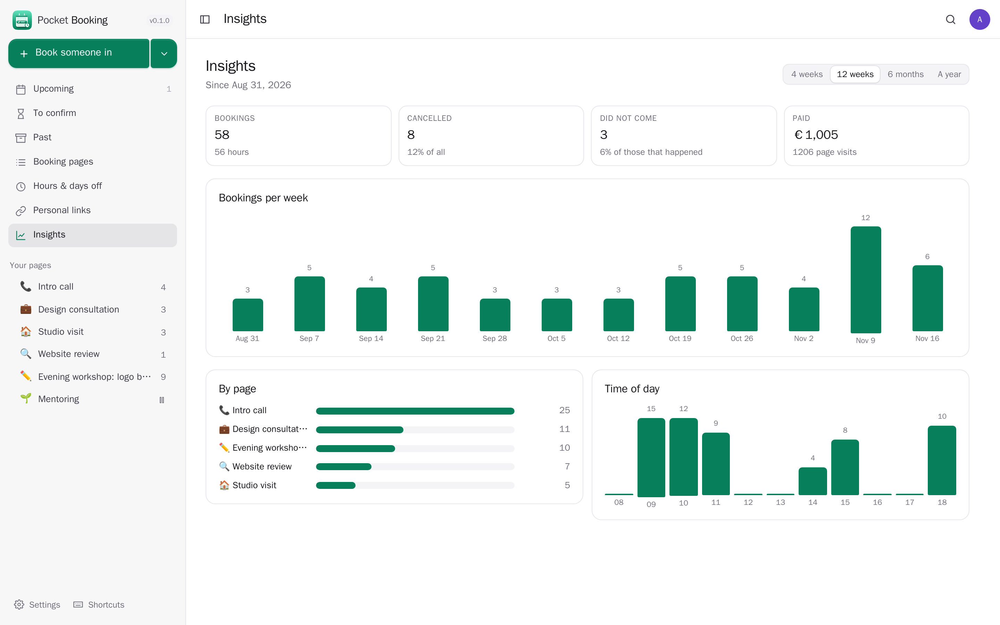
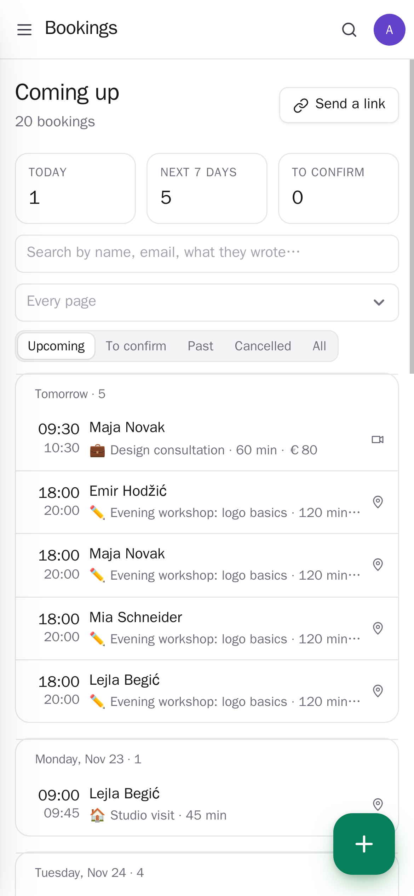
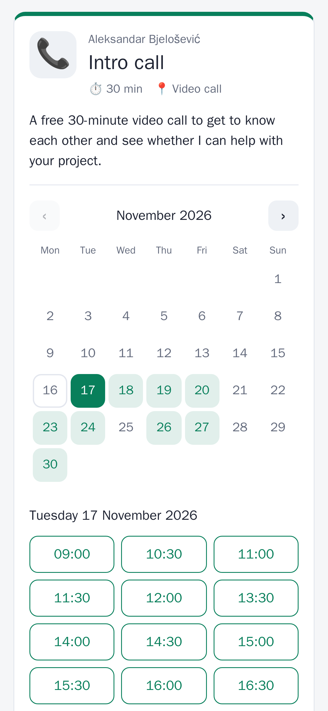

<p align="center"></p>
<h1 align="center">Pocket Booking</h1>
<p align="center">Booking pages people use to pick a free time with you — an intro call, a consultation, a viewing, a lesson, a class — without an account and without emails back and forth. Your weekly hours, your days off and what is already in your calendar decide which times are free. People get a confirmation with a calendar file and a reminder from your own mailbox, and can move or cancel the booking themselves. Each booking can go on to your calendar, contacts, CRM, invoices, money, tasks and notes. Bring your past bookings from Calendly or Cal.com.<br>One Go binary, one SQLite file, one volume. Part of the Pocket apps; works on its own too.</p>
<p align="center">
  <a href="https://github.com/abjelosevic88/pocket-homelab-booking/actions"></a>
  <a href="https://github.com/abjelosevic88/pocket-homelab-booking/pkgs/container/pocket-homelab-booking"></a>
  <a href="LICENSE"></a>
</p>

<p align="center"></p>

<table>
  <tr>
    <td width="50%"></td>
    <td width="50%"></td>
  </tr>
  <tr>
    <td align="center"><sub>The page people book on: a month, the free times of a day, in their time zone if they like.</sub></td>
    <td align="center"><sub>One page per thing people can book, each with its link.</sub></td>
  </tr>
  <tr>
    <td width="50%"></td>
    <td width="50%"></td>
  </tr>
  <tr>
    <td align="center"><sub>Weekly hours with breaks, and the days that differ.</sub></td>
    <td align="center"><sub>Bookings per week, per page and per hour; cancellations and no-shows.</sub></td>
  </tr>
  <tr>
    <td width="50%"></td>
    <td width="50%"></td>
  </tr>
  <tr>
    <td align="center"><sub>Your bookings on the phone.</sub></td>
    <td align="center"><sub>Booking on a phone: no app, no account.</sub></td>
  </tr>
</table>

## What it does

- **Booking pages**: a name, words, one or more lengths (they pick), where (a video call link made for each booking, your own Zoom/Meet link, you call them, they call you, an address or one of your Pocket Places, or they say where), a price with how to pay. Eight ready-made ones (intro call, consultation, meeting, phone call, viewing, lesson, appointment, group class) — or describe it in a sentence and Pocket AI sets it up.
- **When**: weekly hours with breaks, days off and days with other hours, in your time zone; how much notice you need, how far ahead, free time before and after, times every 15/20/30/60 minutes, at most so many a day, several people per time for a class or a tour. A time is checked and taken in one step, so two people never get the same one.
- **Busy in Pocket Calendar** means not bookable (you pick which calendars), and every booking goes into your calendar — moved and removed with it.
- **Public pages without JavaScript**: a month, the free times of a day, a short form with your own questions; phone-first, light and dark, in English, Bosnian, Croatian, Serbian and German, times shown in another time zone if they like. A spam guard (a hidden field, a signed time stamp, a limit per address).
- **The guest's own page**: add to their calendar (.ics), pick another time, or cancel with a message — and you are told.
- **Emails** from your own mailbox through Pocket Mail: a confirmation with a calendar file, a reminder before, and a note when it is confirmed, declined, moved or cancelled.
- **Confirm by hand** when you want to: the time is held until you say yes or no.
- **Personal links** that book once, with their name and email filled in — also from Pocket Contacts and Pocket CRM.
- **Your bookings**: by day, to confirm, past, cancelled; search; book someone in yourself (also outside your hours); move, cancel, mark as happened or no-show, paid; your own note; email them; “Get ready” — a short brief from Pocket AI from what they wrote and their earlier bookings.
- **Insights**: bookings per week, per page and per hour, cancellations, no-shows, paid.
- **Your page** `/p/<name>` that lists all your open pages, for an email signature or a website.
- **Bring bookings in** from Calendly or Cal.com (CSV) or a Pocket Booking export; export everything as JSON.
- **Everyone their own** on one box: each person has their own pages, hours, bookings, settings and connections; admins see no one else's bookings.
- **Pushes** through Apprise, ntfy or a webhook (and to your phones with Pocket Hub): each booking, cancellation and move, and a morning note about the day.

## Run it

```sh
docker run -d --name pocket-booking -p 8080:8080 -v pocket-booking:/data \
  -e BASE_URL=https://booking.example.com -e SECURE_COOKIES=true \
  ghcr.io/abjelosevic88/pocket-homelab-booking:latest
```

or `docker compose up -d` with [docker-compose.yml](docker-compose.yml). Open it, create the first account, set your hours and open a booking page; people book at `https://booking.example.com/b/<address>`. To have the booking pages on the internet while the app stays private, see `PUBLIC_URL` in [docs/configuration.md](docs/configuration.md). Binaries for Linux, macOS, Windows and FreeBSD are on the [releases](https://github.com/abjelosevic88/pocket-homelab-booking/releases) page.

## With Pocket Core

Set `CORE_URL` and `CORE_REGISTRATION_KEY` and Booking joins the box: people sign in with Pocket Core, Pocket AI helps, and through app links each person's bookings go on to their own apps — nothing to paste (or connect an app directly with its URL and a token):

| App | What a booking becomes | Scopes |
|---|---|---|
| Pocket Calendar | busy times are not bookable; each booking is an event, moved and removed with it | `calendar:read`, `calendar:write` |
| Pocket Mail | the guest's confirmation, reminder and changes, from your own mailbox | `mail:send` |
| Pocket Contacts | the person who booked, unless they are there already | `contacts:read`, `contacts:write` |
| Pocket CRM | a lead with what they wrote | `crm:write` |
| Pocket Invoicing | a draft invoice for a booking with a price | `invoices:write` |
| Pocket Money | the payment as income | `accounts:read`, `transactions:write` |
| Pocket Tasks | a task to get ready, or to follow up | `tasks:write` |
| Pocket Notes | a meeting note with who, when and their answers | `notes:write` |
| Pocket Places | where a page's bookings happen | `places:read` |
| Pocket Time | a booking that happened, as time worked | `time:write` |
| Pocket AI | a page from a sentence, a brief before a meeting; the Ask button on every page | inference |

Each page can do these **by itself** for every booking. Other apps read and make bookings through `booking:read` and `booking:write` ([docs/api.md](docs/api.md)): Pocket Day shows the day's bookings, Pocket Search finds them, Pocket Contacts and Pocket CRM show a person's bookings and send a personal link, Pocket AI answers about them and can book, move or cancel when you ask, and Pocket Flows starts flows from `booking.booked`, `booking.cancelled`, `booking.moved` and the rest.

## Develop

```sh
make dev     # API on :8080 with demo data + Vite on :5173
make test    # go vet, go test, tsc
make         # web + binary
```

`node scripts/screenshots.mjs` takes the screenshots above from a demo instance and fails on any browser error. MIT licensed.
